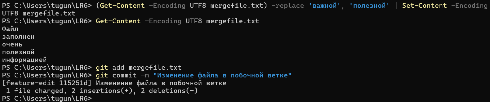
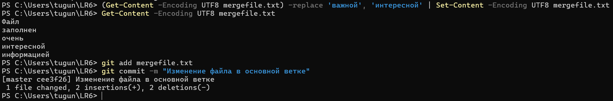
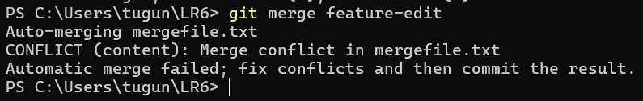
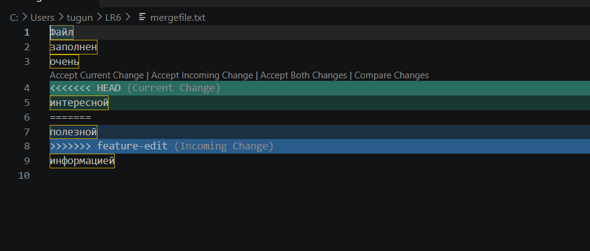
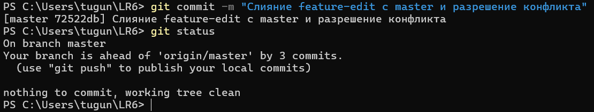
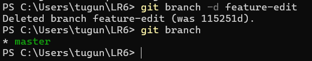
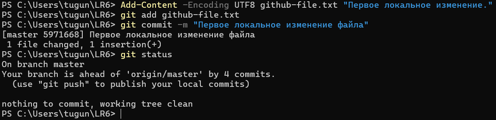
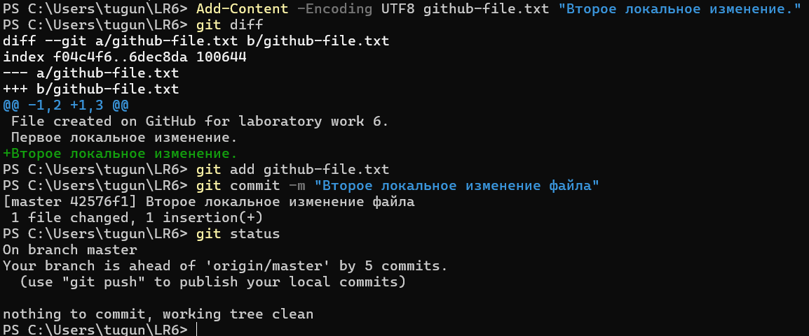
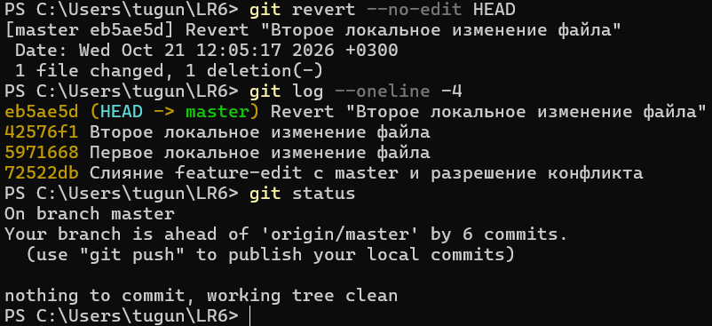
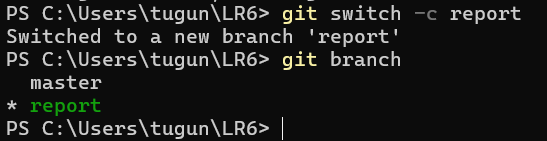

# Лабораторная работа №6
## Система контроля версий

**Выполнила:** Тугунова В. А.  
**Группа:** И4515

## Цель работы

Изучение базовых возможностей системы управления версиями, получение опыта работы с Git API, локальным и удалённым репозиторием.

## Ход выполнения работы

### 1. Подготовка Git и GitHub

Создана личная копия (Fork) репозитория преподавателя. Проверена версия Git, настроены имя пользователя и электронная почта.

### 2. Клонирование репозитория

Репозиторий клонирован на компьютер с помощью `git clone`. Командой `git status` проверено его состояние.


*Рисунок 1 — Проверка состояния локального репозитория*

### 3. Работа с удалённым репозиторием

Через интерфейс GitHub создан файл `github-file.txt`.


*Рисунок 2 — Создание файла в удалённом репозитории*

Изменения загружены в локальный репозиторий командой `git pull origin master`.


*Рисунок 3 — Получение изменений из удалённого репозитория*

### 4. Просмотр истории и изменений

С помощью команд `git branch -a` и `git log` просмотрены ветки и история коммитов.


*Рисунок 4 — Просмотр веток и истории операций*

Командой `git show HEAD` изучены последние изменения.


*Рисунок 5 — Просмотр последнего коммита*

### 5. Слияние веток и разрешение конфликта

Создана побочная ветка `feature-edit`. В файле `mergefile.txt`
изменено слово «важной» на «полезной», после чего выполнен коммит.



*Рисунок 6 — Изменение файла в побочной ветке*

После переключения на `master` то же слово заменено на
«интересной» и выполнен отдельный коммит.



*Рисунок 7 — Изменение файла в основной ветке*

При выполнении команды `git merge feature-edit` возник конфликт,
поскольку одна строка была изменена по-разному в двух ветках.



*Рисунок 8 — Обнаружение конфликта слияния*

Для разрешения конфликта использован редактор Visual Studio Code.
Выбран вариант из ветки `feature-edit` — слово «полезной».



*Рисунок 9 — Конфликтующие изменения в VS Code*

После исправления файла выполнен коммит слияния.
Команда `git status` подтвердила отсутствие незавершённых изменений.



*Рисунок 10 — Успешное завершение слияния*

### 6. Удаление побочной ветки

После успешного слияния локальная ветка `feature-edit`
удалена командой `git branch -d feature-edit`.



*Рисунок 11 — Удаление побочной ветки*

### 7. Создание последовательных коммитов

В файл `github-file.txt` дважды внесены изменения.
Каждое изменение зафиксировано отдельным коммитом
с соответствующим комментарием.



*Рисунок 12 — Первый локальный коммит*



*Рисунок 13 — Второй локальный коммит*

### 8. Откат коммита

Для отмены последнего изменения использована команда
`git revert --no-edit HEAD`.

В результате создан новый коммит, отменяющий изменение,
при этом исходный коммит остался в истории.



*Рисунок 14 — Откат последнего коммита*

### 9. Создание ветки для отчёта

Командой `git switch -c report` создана отдельная ветка
для оформления отчёта.



*Рисунок 15 — Создание ветки для отчёта*


## Лог использованных команд

Ниже приведены команды, использованные при выполнении лабораторной работы, без результатов их выполнения.

```powershell
git --version
git config --global user.name
git config --global user.email
git config --global user.name "И4515 Тугунова В.А."

cd $HOME
git clone https://github.com/w1qcka/LR6.git
cd LR6
git status

git pull origin master
dir
git status

git branch -a
git log --oneline --all --graph --decorate
git show HEAD

Get-Content -Encoding UTF8 mergefile.txt
git switch -c feature-edit
git branch
(Get-Content -Encoding UTF8 mergefile.txt) -replace 'важной', 'полезной' | Set-Content -Encoding UTF8 mergefile.txt
Get-Content -Encoding UTF8 mergefile.txt
git add mergefile.txt
git commit -m "Изменение файла в побочной ветке"

git switch master
(Get-Content -Encoding UTF8 mergefile.txt) -replace 'важной', 'интересной' | Set-Content -Encoding UTF8 mergefile.txt
Get-Content -Encoding UTF8 mergefile.txt
git add mergefile.txt
git commit -m "Изменение файла в основной ветке"

git merge feature-edit
code mergefile.txt
git add mergefile.txt
git commit -m "Слияние feature-edit с master и разрешение конфликта"
git status

git branch -d feature-edit
git branch

Add-Content -Encoding UTF8 github-file.txt "Первое локальное изменение."
git add github-file.txt
git commit -m "Первое локальное изменение файла"
git status

Add-Content -Encoding UTF8 github-file.txt "Второе локальное изменение."
git diff
git add github-file.txt
git commit -m "Второе локальное изменение файла"
git status

git revert --no-edit HEAD
git log --oneline -4
git status

git switch -c report
git branch
mkdir screenshots
code .

git add README.md screenshots/
git commit -m "Добавлена первая часть отчета со скриншотами"
git status
```

## История коммитов

История операций получена в формате: сокращённый хэш, дата, имя автора и комментарий.

```text
334c410 | 2026-10-21 | И4515 Тугунова В.А. | Добавлены этапы работы и лог команд в отчет
5ea0b6f | 2026-10-21 | И4515 Тугунова В.А. | Добавлена первая часть отчета со скриншотами
eb5ae5d | 2026-10-21 | И4515 Тугунова В.А. | Revert "Второе локальное изменение файла"
42576f1 | 2026-10-21 | И4515 Тугунова В.А. | Второе локальное изменение файла
5971668 | 2026-10-21 | И4515 Тугунова В.А. | Первое локальное изменение файла
72522db | 2026-10-21 | И4515 Тугунова В.А. | Слияние feature-edit с master и разрешение конфликта
cee3f26 | 2026-10-21 | И4515 Тугунова В.А. | Изменение файла в основной ветке
115251d | 2026-10-21 | И4515 Тугунова В.А. | Изменение файла в побочной ветке
68447d2 | 2026-10-21 | w1qcka | Create github-file.txt
921f53b | 2020-11-21 | Kurtyanik | Обновление информации
c08a654 | 2020-11-21 | Kurtyanik | Файл создан пустым
3c6e913 | 2020-11-21 | Kurtyanik | Initial commit
```

## Вывод

В ходе лабораторной работы изучены основные возможности системы контроля версий Git. Получены навыки работы с локальным и удалённым репозиториями, просмотра истории изменений, создания и удаления веток, выполнения коммитов и их отмены. Выполнено слияние веток с разрешением конфликта. Отчёт оформлен в Markdown.
