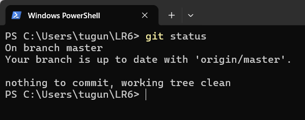
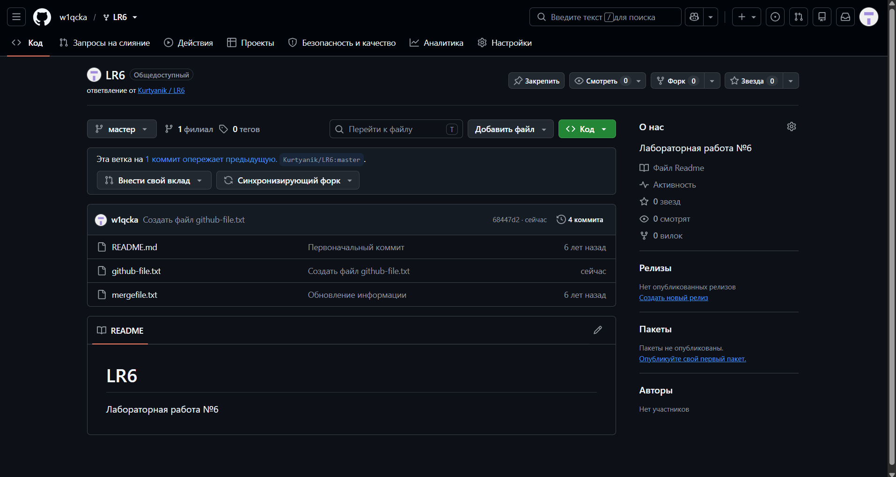
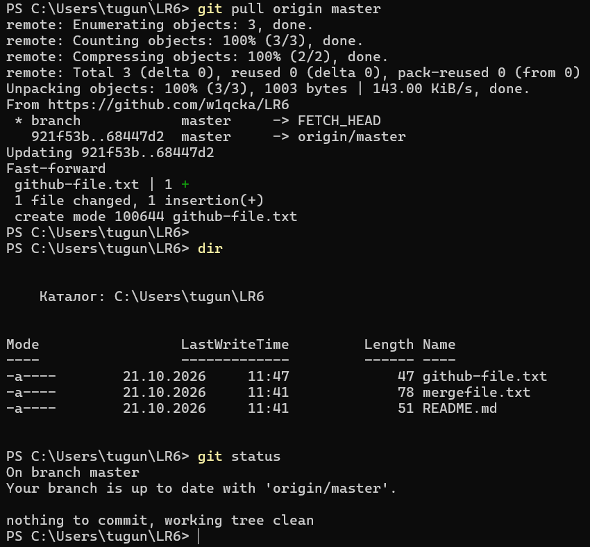
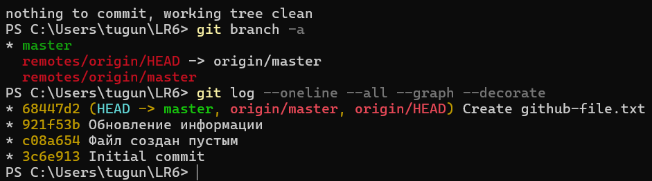
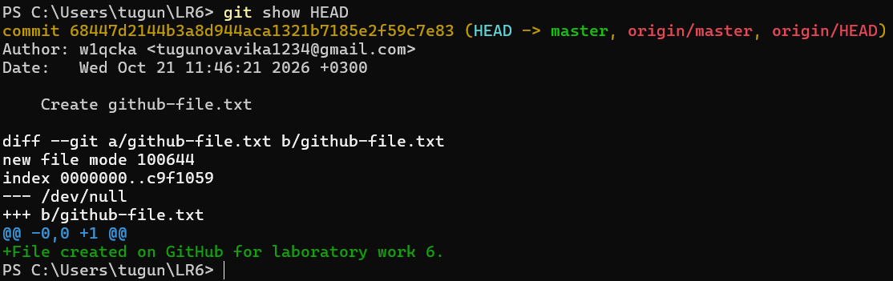

# Лабораторная работа №6
## Система контроля версий

**Выполнила:** Тугунова В. А.  
**Группа:** И4515

## Цель работы

Изучение базовых возможностей системы управления версиями, получение опыта работы с Git API, локальным и удалённым репозиторием.

## Ход выполнения работы

### 1. Подготовка Git и GitHub

Создана личная копия (Fork) репозитория преподавателя. Проверена версия Git, настроены имя пользователя и электронная почта.

### 2. Клонирование репозитория

Репозиторий клонирован на компьютер с помощью `git clone`. Командой `git status` проверено его состояние.

*Рисунок 1 — Проверка состояния локального репозитория*

### 3. Работа с удалённым репозиторием

Через интерфейс GitHub создан файл `github-file.txt`.

*Рисунок 2 — Создание файла в удалённом репозитории*

Изменения загружены в локальный репозиторий командой `git pull origin master`.

*Рисунок 3 — Получение изменений из удалённого репозитория*

### 4. Просмотр истории и изменений

С помощью команд `git branch -a` и `git log` просмотрены ветки и история коммитов.

*Рисунок 4 — Просмотр веток и истории операций*

Командой `git show HEAD` изучены последние изменения.

*Рисунок 5 — Просмотр последнего коммита*